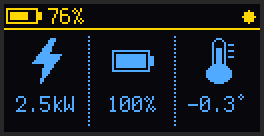
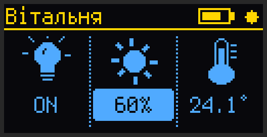
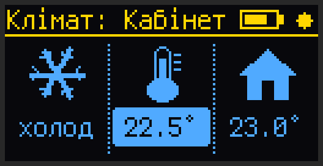
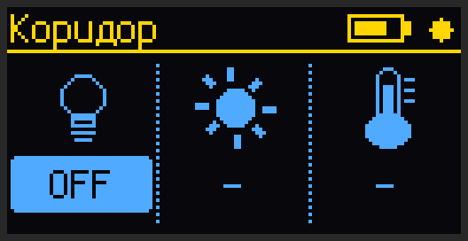
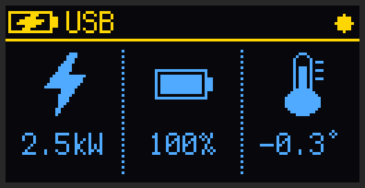
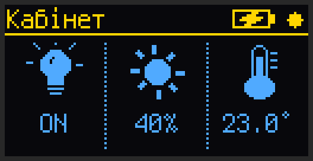
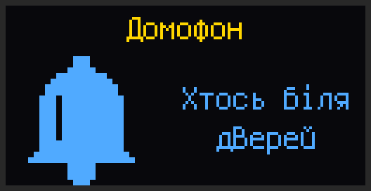
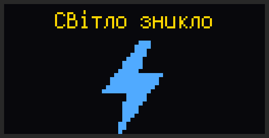
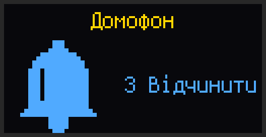
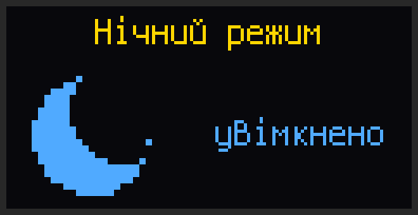

# zb-remote

DIY Zigbee-пульт для Home Assistant: nRF52840 (Pro Micro / nice!nano-клон), 14 кнопок з плати старого ІЧ-пульта, OLED 128×64, живлення від батареї. Працює через Zigbee2MQTT як sleepy end device.


*Рендер справжнього `src/oled.c` на хості (`tools/preview/render.sh`) з симуляцією двоколірного модуля: загальний екран, кімната, сповіщення. Усі екрани — у розділі [Екрани](#екрани).*

## Можливості

- **14 кнопок** × 3 дії (`single` / `double` / `hold`) → `action: "<N>_<дія>"` у Z2M. Кнопки з `NO_DOUBLE_MASK` (`src/buttons.c`: хрестовина 4–8) не мають `double`: `single` іде одразу після відпускання, без 300 мс очікування другого кліку.
- **Екран** керується з HA: 3 плитки «іконка + значення», повноекранне сповіщення (іконка ×2, до 3 рядків, мерехтіння), поворот на 180°, зсув зображення.
- **Батарея** (`genPowerCfg`): відсоток і напруга, звіт щогодини та після натискання. На USB (VBUS через `USBREGSTATUS`, перевірка раз на 3 с) у шапці блискавка замість рівня, Z2M отримує `charging: true`, а відсоток не шлеться: `VDDH` тоді показує напругу USB, не акумулятора. Після відʼєднання батарея перемірюється за 2 с.
- **Zigbee 3.0 sleepy end device**: long poll 5 с, після натискання 10 с (поки світить екран) фіксований poll 100 мс (один запис на пульт ≈ один poll), щоб відповідь HA показувалась одразу (адаптивний turbo poll ZBOSS розганяється до 3 с); звіти, що з'явились до підключення, ставляться в чергу і відправляються після join.
- Пейринг зберігається між прошивками (окремий NVRAM-розділ).

## Екрани

Двоколірний модуль: рядки 0–15 жовті (шапка), решта сині. Усі картинки — рендер справжнього `src/oled.c` (`tools/preview/render.sh` → `docs/screens/`), сцени задані в `tools/preview/preview.c`.

| Екран | Вигляд | Звідки |
|---|---|---|
| **Загальний** (за замовчуванням) |  | `title` порожній → у шапці батарея пульта; плитки: навантаження, батарея дому, температура надворі |
| **Кімната** |  | `title` = кімната; плитки: основне світло, яскравість лампи, температура. Інвертоване значення (`focus`) — те, що змінюють ▲▼ |
| **Кімната → клімат** |  | центр хрестовини: режим / уставка (у фокусі) / поточна температура |
| **Кімната без лампи/датчика** |  | відсутнє значення = «—»; у фокусі основне світло (▲ / ▼ = вкл / вимк) |
| **На USB (зарядка)** |  | блискавка й `USB` замість відсотка; з `title` — блискавка в іконці батареї  |
| **Сповіщення** |  | `alert = "іконка\|заголовок\|рядок2\|рядок3"`: заголовок у жовтій смузі, іконка ×2 трясеться, екран мерехтить |
| **Сповіщення лише із заголовком** |  | `alert = "іконка\|заголовок"` → іконка по центру |
| **Домофон** |  | дзвінок: 3 — відчинити, утримання — скинути |
| **Тост** |  | коротке сповіщення на 3 с (`script.pult_toast`): нічний режим, «усе світло вимкнено», «відчинено» |

Плитки: до 6 символів (шрифт моноширинний 6×12), рядок сповіщення — до 11.

## Залізо

| Вузол | Що | Піни (силкскрін Pro Micro) |
|---|---|---|
| MCU | Pro Micro nRF52840, Adafruit UF2 bootloader 0.6.0 | — |
| OLED | SSD1306 128×64 двоколірний (рядки 0–15 жовті, решта сині), I²C `0x3c` | SDA `017`, SCL `020`, живлення з VCC-ключа `013` |
| Клавіатура | плата ІЧ-пульта, мікросхему випаяно, 6 ліній | три нижні піни з кожного боку: ліворуч `011`, `104`, `106` (GND мікросхеми); праворуч `111`, `010`, `009` |
| LED | синій, вбудований | `015` |
| Батарея | LiPo на `VDDH` (вимір через `VDDH/5`) | — |

### 3D-модель

[`cad/zb-rm.step`](cad/zb-rm.step) — модель пульта (STEP, 8 тіл, експорт з Autodesk 2026-11-23). Відкривається у Fusion, FreeCAD, Onshape або в переглядачі GitHub.

### Клавіатура (pair matrix)

Кожна кнопка замикає **пару** з 6 ліній. Сканування: одна лінія тягнеться в 0, решта читаються з pull-up; період 25 мс, debounce 2 скани. Пари, замкнені без натискання (живлення, конденсатори), запам'ятовуються при старті як baseline й ігноруються.

Лінії (порядок у `kp-gpios`, індекс з 0): `0` = `106` (GND мікросхеми), `1` = `104`, `2` = `009`, `3` = `010`, `4` = `111`, `5` = `011`. Піни `009`/`010` — NFC-виводи; плата в Zephyr уже вмикає `nfct-pins-as-gpios`.

### Кнопки на лицьовій панелі

Нумерація збігається з розташуванням на корпусі (зверху вниз, зліва направо). Таблиця в `src/keymap.h` (поточна плата, визначена 2026-11-22). Порядок дротів залежить від пайки: на іншій платі таблицю треба перевчити (див. нижче).

| № | Підпис на корпусі | Призначення (план) | Підпис | Лінії |
|---|---|---|---|---|
| 1 | ⏻ (червона) | світло в обраній кімнаті вкл/вимк; утримання = вимкнути все | лишити | 010–111 |
| 2 | ⟳ | сцени (по колу, назва на екрані) | лишити | 009–010 |
| 3 | без підпису | домофон: відчинити | нанести 🔔/🔑 | 009–011 |
| 4 | ☼ (верх хрестовини) | яскравість + | лишити | 009–111 |
| 5 | K− | кімната ◀ | стерти → ◀ | 104–010 |
| 6 | ☾ (центр) | нічний режим | лишити | 104–111 |
| 7 | K+ | кімната ▶ | стерти → ▶ | 104–011 |
| 8 | ☼ (низ хрестовини) | яскравість − | лишити | 111–011 |
| 9 | 20% | яскравість 20 % | лишити | 106–010 |
| 10 | 50% | яскравість 50 % | лишити | 106–111 |
| 11 | 100% | яскравість 100 % | лишити | 106–011 |
| 12 | 3000K | гаряча кнопка 1 (TBD) | стерти | 106–104 |
| 13 | 6500K | гаряча кнопка 2 (TBD) | стерти | 106–009 |
| 14 | 4000K | гаряча кнопка 3 (TBD) | стерти | 104–009 |

Тон світла свідомо не використовується: більшість світильників його не вміє. Обрану кімнату й сцену тримає HA (`input_select`) і показує на екрані пульта; прошивка лише надсилає «кнопка N, дія». Подвійні натискання та утримання решти кнопок — резерв під сцени/режими.

**Навчання іншої плати.** Заповнити `keymap` значеннями `{-1, -1}` і перезібрати: при натисканні на екрані й у лозі з'являється `пади a-b`. Нумерація там з 1, у `keymap.h` з 0.

## Збірка та прошивка

Потрібен nRF Connect SDK **v3.4.2** з модулем **ncs-zigbee v2.0.0**.

```sh
. ~/ncs/toolchain-env.sh
cd ~/ncs/v3.4.2
# батарейна збірка (за замовчуванням): без USB, логів і консолі
west build -b promicro_nrf52840/nrf52840/uf2 -d ~/Developer/pet/zb-remote/build ~/Developer/pet/zb-remote
# збірка для розробки: лог через USB CDC (debug.conf)
west build -b promicro_nrf52840/nrf52840/uf2 -d ~/Developer/pet/zb-remote/build-debug ~/Developer/pet/zb-remote -- -DEXTRA_CONF_FILE=debug.conf
```

Прошивка: двічі швидко натиснути RST, щоб з'явився диск `NICENANO`, і скопіювати:

```sh
cp -X build/zb-remote/zephyr/zephyr.uf2 /Volumes/NICENANO/
```

`-X` обов'язковий: без нього macOS намагається скопіювати xattr і `cp` падає.

**Лог** є лише в debug-збірці: USB CDC ACM (`/dev/cu.usbmodem*`, 115200), режим `LOG_MODE_DEFERRED` (immediate-режим вішав прошивку, коли хост переставав читати порт). Debug-збірка до 20 с чекає, поки хост відкриє порт (`CONFIG_APP_WAIT_HOST`). Батарейна збірка стартує одразу, USB вимкнений; прошивається так само через UF2 (подвійний RST).

**Нова плата / самовідновлення.** Якщо в розділах `zboss_nvram` чи `storage` лишились чужі дані, ZBOSS падає на assert у `zb_nvram.c` (file_id 122). `__wrap_zb_assert` запам'ятовує assert у `__noinit`-RAM, і на наступному старті прошивка стирає обидва розділи (NVRAM і PSA ITS з майстер-ключем) та перезавантажується. Пульт виходить з мережі, тож у Z2M треба відкрити permit join.

**Скидання мережі:** утримувати кнопку 1 протягом 10 с.

### Чому конфіг саме такий (особливості цього клону)

| Опція | Причина |
|---|---|
| Legacy USB stack (`USB_DEVICE_STACK_NEXT=n`) | з `device_next` CDC не енумерується (перевірено на `experiments/usb-blinky`) |
| `CLOCK_CONTROL_NRF_K32SRC_RC` | на платі немає кварцу 32 кГц, без цього застосунок висне |
| `ZIGBEE_CHANNEL_SELECTION_MODE_MULTI` | координатор не на 16-му каналі (у нас 11) |
| `ZIGBEE_PRO_CORE_BEHAVIOR_R22` | Z-Stack-координатор не приймає R23 join |
| `sense-edge-mask` у overlay | GPIOTE має лише 8 каналів |
| розділи з `0x26000` | там починається застосунок для UF2 bootloader; NVRAM ZBOSS лежить за кодом і переживає перепрошивку |

## Встановлення в Home Assistant

Усе, що потрібно для відтворення, лежить у цьому репозиторії: прошивка (`src/`, `boards/`), конвертер Zigbee2MQTT (`z2m/`) і пакет Home Assistant (`ha/`). У HA лежать копії; змінювати їх треба тут і розгортати скриптом.

1. **Прошивка** — зібрати й залити (див. [Збірка та прошивка](#збірка-та-прошивка)).
2. **Конвертер Z2M** — `scripts/deploy-ha.sh converter` (або вручну скопіювати `z2m/zb-remote-14.mjs` у `<z2m data>/external_converters/`), перезапустити Zigbee2MQTT.
3. **Приєднати пульт** — увімкнути permit join; новий пульт приєднується сам, вже приєднаний скинути утриманням кнопки 1 протягом 10 с.
4. **Назва в Z2M** — перейменувати пристрій на `zb_remote` (пакет слухає `zigbee2mqtt/zb_remote/action` і пише в `zigbee2mqtt/zb_remote/set`). У нас: Z2M → device rename з `homeassistant_rename`, HA-назва «Пульт».
5. **Пакет HA** — у `configuration.yaml` мають бути пакети (`homeassistant: packages: !include_dir_merge_named packages`); `scripts/deploy-ha.sh package`, потім перезавантажити Input select і Automations.
6. **Адаптувати під свій дім** — у `ha/zb_remote.yaml`: кімнати (`rooms`: основне світло, лампа з яскравістю, датчик температури, клімат і його пресети), сутності домофона, список `input_select.pult_room`, тригери оновлення екрана, сутності загального екрана. Перелік — у шапці файлу.

`HA_SSH` — ssh-alias хоста HA (за замовчуванням `homeassistant`, HAOS з add-on «Advanced SSH & Web Terminal»).

### Що робить пакет `ha/zb_remote.yaml`

Два шари: **глобальні** кнопки завжди роблять одне й те саме (можна наосліп), **контекстні** керують тим, що зараз на екрані.

| Кнопка | Натискання | Утримання |
|---|---|---|
| ⏻ (1) | світло кімнати: щось світить → вимкнути все в кімнаті, інакше — основне | вимкнути все світло в домі |
| ⟳ (2) | на «Загальний» | — |
| домофон (3) | **лише під час дзвінка**: відчинити | скинути |
| 14 | нічний режим вкл / вимк | вимкнути все світло в домі |
| ◀ / ▶ (5 / 7) | попередня / наступна кімната (по колу) | — |
| ▲ / ▼ (4 / 8) | значення у фокусі: яскравість ±10 % або уставка ±0.5°; кімната без лампи — основне світло вкл / вимк | ±30 % / ±2° |
| центр (6) | чим керуємо: світло ↔ клімат (якщо в кімнаті є клімат) | OK: лампа або клімат вкл / вимк |
| 9 / 10 / 11 | пресети: 20 / 50 / 100 % або уставки кімнати (`cpresets`) | — |
| 12, 13 | ще не призначені | |

Що саме змінюють ▲▼, показує інвертована плитка (`focus`). Після зміни кімнати пульт знову керує світлом.

Швидкий відгук:
- плитка показує очікуваний результат одразу, а лампа чи клімат отримують лише фінальне значення серії (скрипти `pult_dim_apply` / `pult_climate_apply`, 0.3 с після останнього натискання);
- 10 с після натискання кроки рахуються від цільового значення (`input_number.pult_target`, `timer.pult_series`), а не від запізнілого стану хмарних ламп;
- пульт у цей час опитує батька раз на 100 мс, конвертер об'єднує записи на екран.

Решта значень оновлюється раз на 5 хв. Через 2 хв без натискань пульт повертається на «Загальний».

## Zigbee2MQTT

### Кластер дисплея `0xFC10` (manufacturer-specific, ендпоінт 1)

| Атрибут | Тип | Ключ Z2M | Зміст |
|---|---|---|---|
| `0x0000`–`0x0002` | octet string ≤ 48 B | `tile1`–`tile3` | `"іконка\|значення"` |
| `0x0003` | uint8 | `wake` | увімкнути екран на N с |
| `0x0004` | octet string | `alert` | `"іконка\|заголовок\|рядок2\|рядок3"` (заголовок у жовтій смузі), порожній рядок прибирає сповіщення |
| `0x0009` | octet string ≤ 48 B | `title` | текст у жовтій шапці (обрана кімната); порожній = відсоток батареї |
| `0x000A` | uint8, лише читання | `charging` | 1 = живлення від USB; пристрій сам шле звіт при зміні |
| `0x000B` | uint8 | `focus` | плитка 1–3, значення якої змінюють ▲▼ (малюється інвертованим), 0 = нічого |
| `0x0005` | uint8 | `flip` | поворот на 180° |
| `0x0006` / `0x0007` | int8 | `offset_x` / `offset_y` | зсув зображення, на 20 с показує калібрувальну рамку |

Особливості:
- Z2M викликає конвертер **один раз на повідомлення**, тому всі ключі пишуться одним `ep.write`.
- Рядки треба передавати як `OCTET_STR` + `Buffer`: масив байтів типу `CHAR_STR` дає `MALFORMED_COMMAND`.
- Довгий текст обрізається по межі: у плитці влазить 6 символів, у рядку сповіщення 11.

### Приклади з HA

```yaml
# сповіщення
action: mqtt.publish
data:
  topic: zigbee2mqtt/<friendly_name>/set
  payload: '{"alert": "bell|Домофон|Хтось біля|дверей"}'

# плитки
action: mqtt.publish
data:
  topic: zigbee2mqtt/<friendly_name>/set
  payload: >-
    {"tile1": "temp|{{ states('sensor.kitchen_temperature') }}°",
     "tile2": "bulb|{{ 'ON' if is_state('light.kitchen', 'on') else 'OFF' }}"}
```

```yaml
# тригер на кнопку
triggers:
  - trigger: state
    entity_id: event.<remote>_action   # або sensor.<remote>_action
    to: "3_single"
```

### Іконки


`bell door door_open lock unlock bulb bulb_off temp power battery home moon sun flame snow drop plug fan check cross link search star cam tv button`

## Структура

```
src/
  main.c             Zigbee: ендпоінт, кластери, звіти, сигнали, логіка кнопок → дисплей
  keypad.c           сканування pair-matrix клавіатури
  keymap.h           кнопка → пара ліній
  buttons.c          single / double / hold (600 / 300 мс)
  oled.c             рендер UI (плитки, сповіщення, статус-бар, орієнтація)
  display_cluster.c  кластер 0xFC10 → oled
  battery.c, led.c
  font_terminus12.c  згенеровано tools/genfont.py (Terminus 12 px)
  icons.c            згенеровано tools/icons.py
cad/zb-rm.step       3D-модель пульта (STEP)
boards/              overlay для promicro_nrf52840/nrf52840/uf2
z2m/                 external converter для Zigbee2MQTT
ha/                  пакет Home Assistant (/config/packages/zb_remote.yaml): кімнати, кнопки, екран
scripts/deploy-ha.sh розгортання конвертера й пакета в HA по SSH
tools/
  icons.py           піксель-арт іконки 24×24 → src/icons.c (+ docs/icons.png)
  genfont.py         TTF → 1-бітний пропорційний шрифт (ASCII + українська)
  preview/           рендер src/oled.c на хості → docs/screens/*.png, docs/preview.png
experiments/usb-blinky  мінімальний тест USB CDC (legacy vs device_next)
```

Перегенерація ресурсів (потрібен Pillow):

```sh
python3 tools/icons.py src/icons.c docs/icons.png
# Terminus (TTF): https://files.ax86.net/terminus-ttf/
python3 tools/genfont.py TerminusTTF-4.49.3.ttf 12 src/font_terminus12.c
tools/preview/render.sh
```

**Шрифт:** [Terminus (TTF)](https://files.ax86.net/terminus-ttf/) 12 px (6×12), моноширинний піксельний, з українською. Ліцензія SIL OFL 1.1, див. `fonts/Terminus-OFL.txt`. Кирилична «д» у Terminus схожа на латинську «g», тому в `tools/genfont.py` вона перемальована вручну (`OVERRIDES`).

## Статус і плани

- [x] Zigbee join, дії, батарея, дисплей з HA
- [x] Клавіатура з ІЧ-пульта (14 кнопок, 6 ліній)
- [x] OLED 128×64
- [x] Клавіатура на нижніх пінах, 128×64 і keymap перевірені на залізі (друга плата)
- [ ] Стерти підписи K−/K+/3000K/4000K/6500K, нанести значок на кнопку домофона
- [x] Батарейна збірка (без USB/логів); debug-збірка через `debug.conf`
- [ ] Виміряти струм сну
- [x] Батарея на USB: детект VBUS → блискавка в шапці, `charging` у Z2M, хибний відсоток не шлеться
- [x] Заголовок у шапці `0x0009` (прошито 2026-11-23)
- [ ] Кінець зарядки не видно: пін CHRG зарядного чипа не заведений на MCU
- [x] Модель керування: глобальні кнопки + кімната з підрежимами світло / клімат, фокус на екрані, домофон, нічний режим
- [ ] Кнопки 12, 13
- [ ] ІЧ-бластер на світлодіоді старого пульта (опційно)
